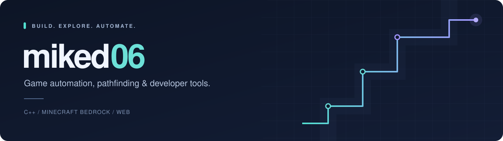

  

  <strong>I build tools that turn complex tasks into simple commands.</strong> 
  Working on Minecraft Bedrock automation, native C++ systems, and interactive web experiences.

  <a href="https://github.com/miked06/baritone-bedrock">Flagship project</a> &nbsp;·&nbsp;
  <a href="https://miked06.github.io/baritone-bedrock-website/">Live website</a> &nbsp;·&nbsp;
  <a href="https://github.com/miked06/baritone-bedrock/issues">Discuss an idea</a>

## Selected work

### [Baritone Bedrock](https://github.com/miked06/baritone-bedrock)

A native C++ port of [Baritone](https://github.com/cabaletta/baritone) for Minecraft Bedrock on Windows. Pathfinding, mining, building, farming, and elytra navigation, controlled through in-game chat commands.

- **Pathfinding:** A* search, movement planning, and terrain caching.
- **Automation:** command-driven workflows for navigating and interacting with the world.
- **Engineering:** a standalone pathfinding core with offline tests and documented game integration.

**C++ · CMake · Windows**

[Explore the code](https://github.com/miked06/baritone-bedrock) &nbsp;↗&nbsp; [Read the architecture](https://github.com/miked06/baritone-bedrock/blob/main/docs/ARCHITECTURE.md)

### [Baritone Bedrock Website](https://github.com/miked06/baritone-bedrock-website)

A project website with an interactive A* pathfinding demo, an animated voxel scene, gameplay media, and guides. Built with HTML, CSS, and JavaScript and hosted on GitHub Pages.

**JavaScript · HTML · CSS · GitHub Pages**

[Visit the website](https://miked06.github.io/baritone-bedrock-website/) &nbsp;↗&nbsp; [Explore the code](https://github.com/miked06/baritone-bedrock-website)

## Tools & focus

  
  
  
  
  
  

Currently focused on **pathfinding algorithms**, **game automation**, and **clear documentation** that helps people use and contribute to my projects.

---

Have a bug report, feature idea, or technical question? [Start a conversation in the project issues.](https://github.com/miked06/baritone-bedrock/issues)
